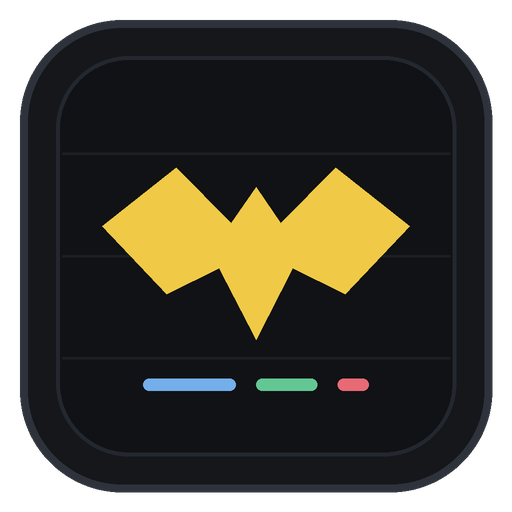
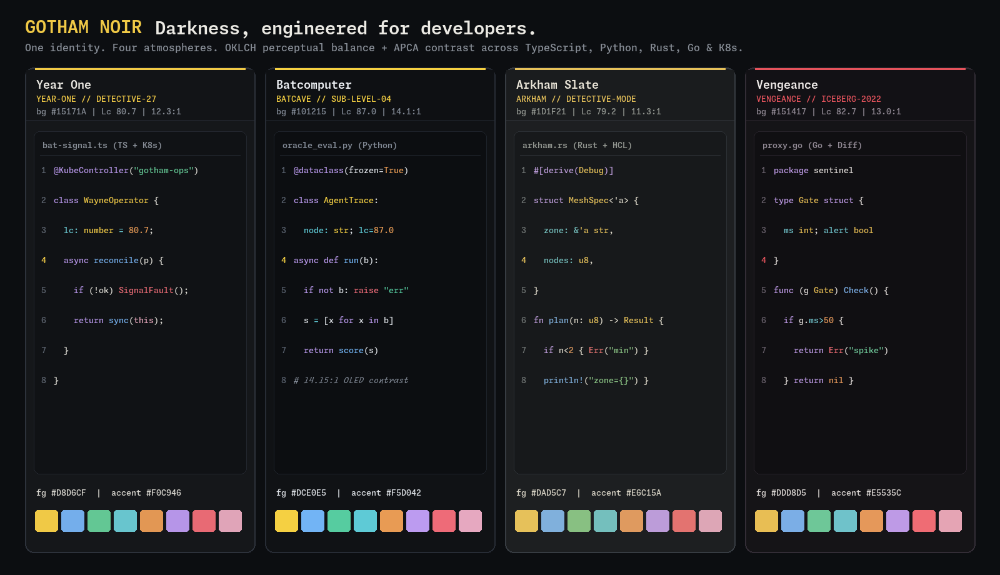
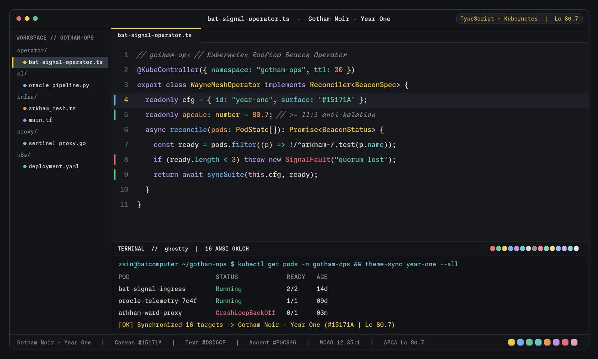
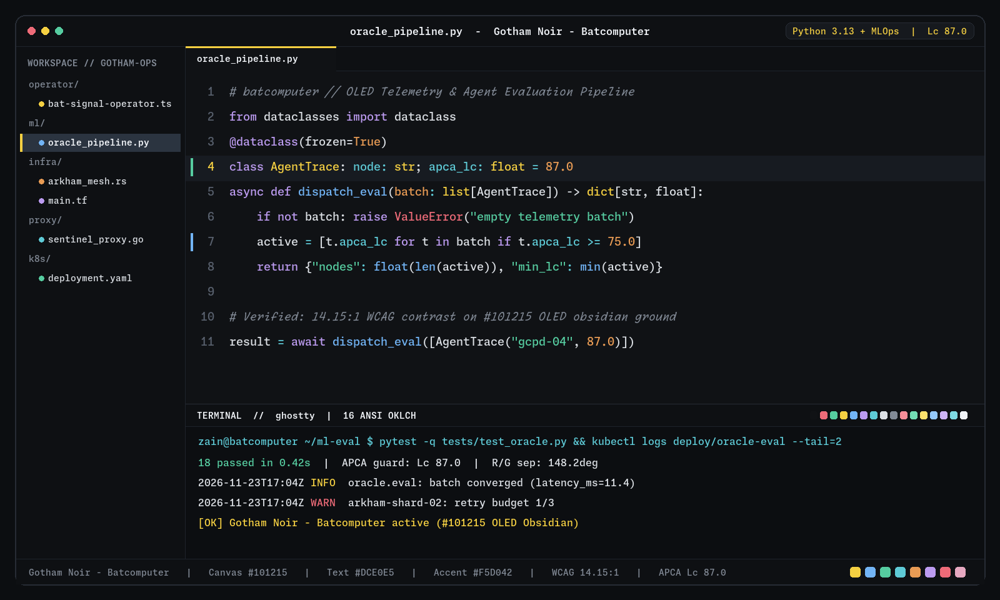
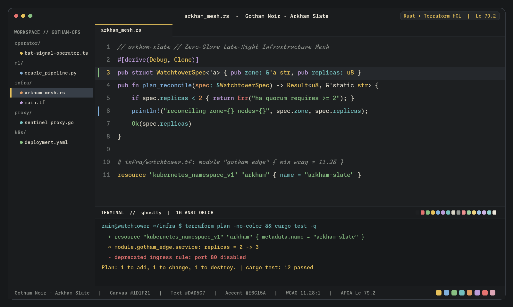
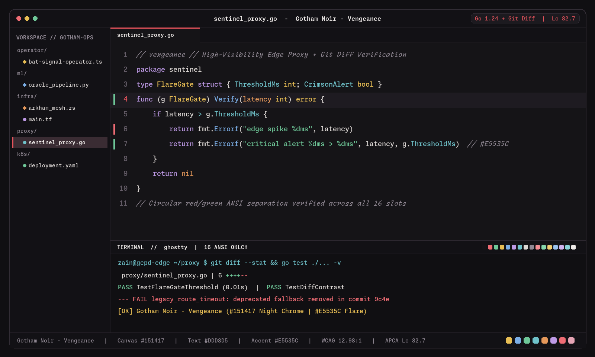

<p align="center">
  <br>
  <strong>Darkness, engineered for developers.</strong><br>
  <sub>One identity. Four atmospheres. Every developer environment.</sub><br><br>
  
</p>

# Gotham Noir

[](https://gothamnoir.zainahmed.net)
[](https://github.com/thezaynahmed/gotham-noir/actions/workflows/validate.yml)
[](LICENSE)
[](#the-4-dark-variants)
[](#apps-and-ports)

Dark themes that won't fry your eyes at 3 AM, bury functions in muddy navy, or break `git diff`. Built for developers, AI coding agents, MLOps, and DevOps engineers by [Zain Ahmed](https://zainahmed.net/): **Gotham Noir** compiles 4 dark-only variants from one canonical palette source with OKLCH perceptual balance and APCA contrast across **20+ editors, terminals, browsers, and design systems**.

<details>
  <summary>Table of Contents</summary>

- [Why Gotham Noir](#why-gotham-noir)
- [Quick Start](#quick-start)
- [The 4 Dark Variants](#the-4-dark-variants)
- [Apps and Ports](#apps-and-ports)
- [Palette and Color Architecture](#palette-and-color-architecture)
- [AI Agent Support and Skills](#ai-agent-support-and-skills)
- [Build, Security and Community](#build-security-and-community)

</details>

---

## Why Gotham Noir

Classic nocturnal dark themes looked great in screenshots, then broke down during real engineering work: `#000000`/`#FFFFFF` halation fatigued eyes, `2.8:1` navy functions disappeared on dark gray, and yellow-on-yellow ANSI schemes turned `git diff` and Kubernetes logs into guesswork.

I engineered **Gotham Noir** from color science first: anti-halation matte canvases, equalized OKLCH syntax lightness, and an automated WCAG 2.1 + APCA contrast gate in CI. Each palette translates optical clarity into classic 1930s-to-modern detective noir atmosphere: matte Kevlar charcoal, rooftop signal gold, sub-level mainframe emerald, and rain-slicked crimson flare.

| Pain Point in Legacy Dark Themes | Gotham Noir Engineering Fix |
| :--- | :--- |
| `#000000` / `#FFFFFF` screen halation and eye shimmer | Softened charcoal canvases (`#101215` to `#1D1F21`) paired with warm parchment (`#D8D6CF` to `#DCE0E5`) |
| Functions and types buried at `< 3:1` contrast | `11.28:1` to `14.15:1` primary WCAG contrast (`Lc 79.2` to `87.0` APCA) across every variant |
| Muddy ANSI red/green collisions in `git diff` | >= 110 degree circular hue separation between crimson alerts and emerald additions |

---

## Quick Start

Install via [GitHub Releases](https://github.com/thezaynahmed/gotham-noir/releases/latest) (no clone required), sync all terminals & IDEs in one line via [`ghostty-config`](https://github.com/thezaynahmed/ghostty-config), or add directly to **shadcn/ui**:

**1. One-line universal terminal & IDE setup (macOS & Linux):**

`curl -fsSL https://raw.githubusercontent.com/thezaynahmed/ghostty-config/main/install.sh | bash -s -- --all`

```bash
# Switch all synced terminals and IDEs at once:
theme-sync year-one --all
```

**2. shadcn/ui (Tailwind v4 & v3):**

```bash
npx shadcn@latest add https://raw.githubusercontent.com/thezaynahmed/gotham-noir/main/ports/shadcn/r/gotham-noir.json
```

**3. VS Code, Cursor, Windsurf, Antigravity IDE (no git clone needed):**

Download `gotham-noir-1.0.0.vsix` from [Releases](https://github.com/thezaynahmed/gotham-noir/releases/latest) and run:

```bash
code --install-extension gotham-noir-1.0.0.vsix   # or: cursor / windsurf / antigravity-ide
```

---

## The 4 Dark Variants

<p align="center">
  
</p>

<details>
  <summary>View full high-resolution screenshots for Batcomputer, Arkham Slate, and Vengeance</summary>

#### Gotham Noir - Batcomputer (Python 3.13 + MLOps)


#### Gotham Noir - Arkham Slate (Rust + Terraform HCL)


#### Gotham Noir - Vengeance (Go + Git Diff)


</details>

| Variant | Canvas | Text | Accent | WCAG / APCA Lc | Best For |
| :--- | :--- | :--- | :--- | :--- | :--- |
| **`Gotham Noir - Year One`** *(Flagship)* | `#15171A` | `#D8D6CF` | `#F0C946` | `12.35:1` / `Lc 80.7` | Balanced matte Kevlar + rooftop signal gold for all-day coding |
| **`Gotham Noir - Batcomputer`** | `#101215` | `#DCE0E5` | `#F5D042` + `#56CCA0` | `14.15:1` / `Lc 87.0` | OLED obsidian control plane for AI agents, K8s, and MLOps logs |
| **`Gotham Noir - Arkham Slate`** | `#1D1F21` | `#DAD5C7` | `#E6C15A` | `11.28:1` / `Lc 79.2` | Weathered warm slate + antique gold for 3 AM zero-glare focus |
| **`Gotham Noir - Vengeance`** | `#151417` | `#DDD8D5` | `#E5535C` | `12.98:1` / `Lc 82.7` | Rain-soaked dark chrome + crimson flare for high-focus nights |

---

## Apps and Ports

| App | What Is Included | Path |
| :--- | :--- | :--- |
| **[Zed](packages/zed/)** | Official `v0.2.0` editor theme family + `extension.toml` | [`packages/zed/`](packages/zed/) |
| **[VS Code / Cursor / Windsurf / Antigravity IDE](packages/vscode/)** | `.vsix` extension (all 4 variants, 2027 AI agent tokens) | [`packages/vscode/`](packages/vscode/) |
| **[Neovim](ports/neovim/)** | `lazy.nvim` Lua colorscheme plugin + Treesitter + LSP | [`ports/neovim/`](ports/neovim/) |
| **[JetBrains](ports/jetbrains/)** | `.icls` XML schemes for IntelliJ IDEA, PyCharm, GoLand, RustRover | [`ports/jetbrains/`](ports/jetbrains/) |
| **[Ghostty](ports/ghostty/)** | Native themes (`ghostty +validate-config` verified) | [`ports/ghostty/`](ports/ghostty/) |
| **[Windows Terminal & PowerShell](ports/windows-terminal/)** | Store/Preview/Unpackaged installer + JSON Fragment + `PSReadLine` | [`ports/windows-terminal/`](ports/windows-terminal/) |
| **[macOS Terminal.app](ports/macos-terminal/)** | AppKit `NSKeyedArchiver` `.terminal` profiles + curl one-liner | [`ports/macos-terminal/`](ports/macos-terminal/) |
| **[Warp](ports/warp/)** | Terminal theme YAML files (`warpdotdev/themes` ready) | [`ports/warp/`](ports/warp/) |
| **[Herdr](ports/herdr/)** | App themes (4 dark variants + warm daylight light) + syntax mod | [`ports/herdr/`](ports/herdr/) |
| **[GitHub](ports/github/)** | Stylus UserStyle for GitHub UI, diffs, and code blocks | [`ports/github/`](ports/github/) |
| **[Linear](ports/linear/)** | Interface theme LCH JSON strings + code block UserStyle | [`ports/linear/`](ports/linear/) |
| **[Slack](ports/slack/)** | Copy-pasteable 10-color and 4-color sidebar themes | [`ports/slack/`](ports/slack/) |
| **[Chrome](ports/chrome/)** | Manifest V3 browser themes (unpacked loadable folders) | [`ports/chrome/`](ports/chrome/) |
| **[shadcn/ui](ports/shadcn/)** | Tailwind v4/v3 CSS tokens + `npx shadcn add` registry JSON | [`ports/shadcn/`](ports/shadcn/) |
| **[Palette](ports/palette/)** | `gotham-noir.css`, `gotham.css`, and W3C `tokens.json` (hex + OKLCH) | [`ports/palette/`](ports/palette/) |
| **[Fonts](ports/fonts/)** | Dyslexia & readability typography presets (`Monaspace`, `Intel One`, `Atkinson`) | [`ports/fonts/`](ports/fonts/) |
| **[Kitty / Alacritty / WezTerm](ports/kitty/)** | Native Kitty (`kitty +kitten themes` merged!), Alacritty TOML, WezTerm Lua | [`ports/kitty/`](ports/kitty/), [`ports/alacritty/`](ports/alacritty/), [`ports/wezterm/`](ports/wezterm/) |
| **[iTerm2](ports/iterm2/)** | `.itermcolors` Apple XML plists + Dynamic Profiles JSON | [`ports/iterm2/`](ports/iterm2/) |
| **[Paradev / Antigravity App / tmux / Zsh](ports/paradev/)** | Paradev JSON, Regular Antigravity 3-color presets, tmux split dimming, `LS_COLORS` | [`ports/paradev/`](ports/paradev/), [`ports/antigravity-app/`](ports/antigravity-app/), [`ports/tmux/`](ports/tmux/) |

---

## Palette and Color Architecture

Flagship **Year One** swatches (full tokens in [`ports/palette/gotham-noir.css`](ports/palette/gotham-noir.css) and [`ports/palette/tokens.json`](ports/palette/tokens.json)):

| Swatch | Role | Semantic Assignment |
| :--- | :--- | :--- |
|  | **Nomex Kevlar** | Matte anti-halation editor and terminal canvas |
|  | **Parchment** | Primary identifiers and warm neutral body text |
|  | **Signal Gold** | Classes, types, interfaces, active cursor, active line number |
|  | **Detective Blue** | Functions, methods, HTML/JSX tags, and IaC resources |
|  | **Oracle Emerald** | Strings, `git diff` additions, and passing test checks |
|  | **Cryo Sonar Cyan** | Operators, regex escapes, YAML/JSON keys, and builtins |
|  | **Utility Brass** | Numbers, booleans, constants, and function parameters |
|  | **Noir Violet** | Control keywords (`async`, `return`, `import`) and decorators |
|  | **Alert Crimson** | Errors, `git diff` deletions, and mismatched brackets |

---

## AI Agent Support and Skills

This repository ships full native support for **Claude Code**, **Codex**, **Cursor**, **Antigravity**, **Gemini CLI**, **Windsurf**, and **Superset**:

- **Installable Agent Skill:** [`skills/gotham-noir/SKILL.md`](skills/gotham-noir/SKILL.md) (`npx skills add thezaynahmed/gotham-noir`)
- **Agent Entrypoints:** [`AGENTS.md`](AGENTS.md), [`CLAUDE.md`](CLAUDE.md), and [`llms.txt`](llms.txt)

Paste into any coding agent to install and verify automatically:

```text
Clone https://github.com/thezaynahmed/gotham-noir.git, read AGENTS.md (or skills/gotham-noir/SKILL.md), install Gotham Noir for my editors, terminals, and apps, and verify with python3 -m unittest discover -s tests -v.
```

---

## Build, Security and Community

Regenerate every port from [`palettes/`](palettes/), run contrast + E2E tests, and build the `.vsix` locally:

```bash
python3 scripts/build.py
python3 -m unittest discover -s tests -v
cd packages/vscode && npx --yes @vscode/vsce package -o gotham-noir-1.0.0.vsix
```

- **Website:** [gothamnoir.zainahmed.net](https://gothamnoir.zainahmed.net)
- **Maintainer:** Zain Ahmed ([`@thezaynahmed`](https://github.com/thezaynahmed) | [zainahmed.net](https://zainahmed.net/))
- **Governance & Community:** [Contributing](CONTRIBUTING.md) | [Code of Conduct](CODE_OF_CONDUCT.md) | [Security Policy](SECURITY.md) | [Publishing Guide](PUBLISH.md) | [GitHub Issues](https://github.com/thezaynahmed/gotham-noir/issues)
- **Independent Project Notice:** Gotham Noir is an independent, original open-source color system created by Zain Ahmed and is not affiliated with or endorsed by any studio or publisher.
- **License:** [MIT](LICENSE)
