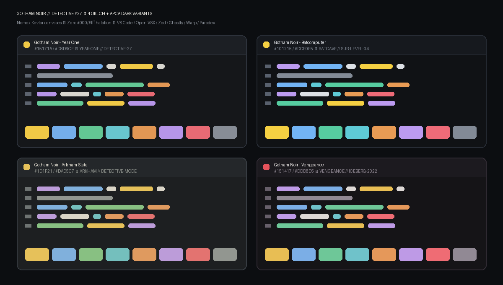

# Gotham Noir

<p align="center">
  
</p>

> *"Without fear, life has no meaning."* — **Detective Comics #27 · Gotham, Year One**

**Gotham Noir** is a dark-only, Single-Source-of-Truth (SSOT) theme ecosystem built for Batman fans and **2027 AI coding agents, MLOps, DevOps, and software engineers**.

Every color across all 4 lore-accurate variants and 20+ editors/terminals compiles from canonical JSON palettes ([`palettes/`](palettes/)) and passes an automated **WCAG 2.1 + APCA Lc** contrast gate.

---

## 4 Lore-Accurate Dark-Only Variants

| Variant | Background | Foreground | Accent | WCAG FG / APCA Lc | Batman Lore & Era |
| :--- | :--- | :--- | :--- | :--- | :--- |
| **`Gotham Noir - Year One`** *(Flagship)* | `#15171A` | `#D8D6CF` | `#F0C946` GCPD Signal | `12.35:1` / `Lc 80.7` | *Detective Comics #27 (1939)* · *Year One (1987)* · *'89 Kevlar* |
| **`Gotham Noir - Batcomputer`** | `#101215` | `#DCE0E5` | `#F5D042` + `#56CCA0` | `14.15:1` / `Lc 87.0` | *Sub-Level 04 Mainframe* · *Lucius Fox Applied Sciences* · *Oracle CRT* |
| **`Gotham Noir - Arkham Slate`** | `#1D1F21` | `#DAD5C7` | `#E6C15A` Antique Gold | `11.28:1` / `Lc 79.2` | *Arkham Island Stonework* · *Detective Mode HUD* · *3 AM Zero-Glare* |
| **`Gotham Noir - Vengeance`** | `#151417` | `#DDD8D5` | `#E5535C` Crimson | `12.98:1` / `Lc 82.7` | *The Batman (2022)* · *Iceberg Lounge Flare* · *Red Hood / Phantasm* |

---

## Lore & Token Codex + Fan Easter Eggs

1. **VS Code Scope Inspector Easter Egg**: Run *Developer: Inspect Editor Tokens and Scopes* to see the WayneTech codex (`Nomex Kevlar`, `Crime Alley`, `GCPD Signal`, `Detective Mode`, `Oracle Emerald`, `Cryo Sonar`, `Utility Belt Brass`, `Ace Chemicals Violet`, `Red Hood Crimson`, `Martha's Pearl`, `Gotham Fog`).
2. **Ghostty CLI Fan Aliases & `--signal` Easter Egg** (via [`ghostty-config`](https://github.com/thezaynahmed/ghostty-config)):
   - `ghostty-theme batman --all` / `year-one` / `detective-27` / `89` → **`Gotham Noir - Year One`**
   - `ghostty-theme batcomputer --all` / `batcave` / `oracle` / `brother-eye` / `lucius` → **`Gotham Noir - Batcomputer`**
   - `ghostty-theme arkham --all` / `detective-mode` / `narrows` / `asylum` → **`Gotham Noir - Arkham Slate`**
   - `ghostty-theme vengeance --all` / `2022` / `red-hood` / `phantasm` / `iceberg` → **`Gotham Noir - Vengeance`**
   - `ghostty-theme --signal` → Prints a read-only **WAYNE ENTERPRISES // BATCOMPUTER DIAGNOSTIC (DETECTIVE #27)** card with live ANSI swatches.
3. **6-Level Bracket Pair Lore**: `GCPD Signal` → `Detective Mode` → `Ace Chemicals Violet` → `Cryo Sonar` → `Oracle Emerald` → `Utility Belt Brass`, with `Scarecrow Alert` (`#FF5C6C`) for mismatched brackets.

---

## Design Principles

1. **Zero `#000000` / `#FFFFFF` Halation** — Eliminates astigmatism blooming and screen glare during long night sessions.
2. **OKLCH Perceptual Balance** — Functions (`Detective Mode`), strings (`Oracle Emerald`), keywords (`Ace Chemicals Violet`), operators (`Cryo Sonar`), constants (`Utility Belt Brass`), and types (`GCPD Signal`) sit in harmonized luminance bands.
3. **True ANSI Semantic Separation** — `Red Hood Crimson` and `Oracle Emerald` maintain >110°–160° hue separation for `git diff`, pytest, CI, and Kubernetes logs.
4. **2027 AI Agent Ready** — Native styling for `inlineChat`, `chat`, `agentsChatInput`, `editorGhostText`, `editorStickyScroll`, `editorInlayHint`, `diffEditor`, and `terminalCommandDecoration`.

---

## Font Stack & Dyslexia / Readability Presets

Default typography keeps **Monaspace Neon** (+ **Monaspace Radon** italics), with ready-to-use configs in [`ports/ide-settings/font-presets.json`](ports/ide-settings/font-presets.json) and [`ports/linux-fontconfig/70-gotham-noir-fonts.conf`](ports/linux-fontconfig/70-gotham-noir-fonts.conf):

1. **Monaspace Neon + Radon** *(Default)* — GitHub Texture Healing (`+calt +ss01..ss03 +zero +cv10`).
2. **Monaspace Argon + Radon** — Wider humanist proportions for enhanced dyslexia legibility.
3. **Intel One Mono** — Designed by Frere-Jones Type to eliminate `b/d/p/q` and `1/l/I` confusion.
4. **Atkinson Hyperlegible Mono** — Braille Institute's 2025 monospaced release (SIL OFL) for maximum homoglyph clarity.
5. **Commit Mono** — Ultra-neutral geometry with customizable alternates.

---

## Supported Targets

| Platform | Location | Format |
| :--- | :--- | :--- |
| **VS Code / Cursor / Windsurf / Antigravity IDE** | [`packages/vscode/`](packages/vscode/) | Publishable `.vsix` extension (all 4 lore variants) |
| **Zed** | [`packages/zed/`](packages/zed/) | Official `v0.2.0` theme family JSON + `extension.toml` |
| **Regular Antigravity (Native Appearance)** | [`ports/antigravity-app/`](ports/antigravity-app/) | 3-color presets (`Background`, `Foreground`, `Accent`, `Contrast`) |
| **Ghostty** (macOS & Linux) | [`ports/ghostty/`](ports/ghostty/) | Native Ghostty theme files (`ghostty +validate-config` verified) |
| **Warp** | [`ports/warp/`](ports/warp/) | `warpdotdev/themes` YAML files |
| **Alacritty** | [`ports/alacritty/`](ports/alacritty/) | Standalone `.toml` themes + full `alacritty.toml` |
| **WezTerm** | [`ports/wezterm/`](ports/wezterm/) | Color scheme `.toml` files + `wezterm.lua` |
| **Kitty** | [`ports/kitty/`](ports/kitty/) | `kitty-themes` metadata `.conf` files + `kitty.conf` |
| **iTerm2** | [`ports/iterm2/`](ports/iterm2/) | Apple XML `.itermcolors` + Dynamic Profiles JSON |
| **macOS Terminal.app** | [`ports/macos-terminal/`](ports/macos-terminal/) | Native XML `.terminal` plists (`NSKeyedArchiver`) + installer |
| **Windows Terminal** | [`ports/windows-terminal/`](ports/windows-terminal/) | `gotham-noir-schemes.json` |
| **tmux / Zsh / Fontconfig** | [`ports/tmux/`](ports/tmux/), [`ports/zsh/`](ports/zsh/), [`ports/linux-fontconfig/`](ports/linux-fontconfig/) | Split dimming, steady block cursor, `LS_COLORS` |
| **Paradev (Superset)** | [`ports/paradev/`](ports/paradev/) | Paradev custom theme definitions |

---

## Build, Verify & Package Locally

```bash
python3 scripts/build.py
python3 -m unittest discover -s tests -v
cd packages/vscode && npx --yes @vscode/vsce package -o gotham-noir-1.0.0.vsix
```

See [`PUBLISH.md`](PUBLISH.md) for copy-paste publishing commands.

## License

[MIT](LICENSE)
