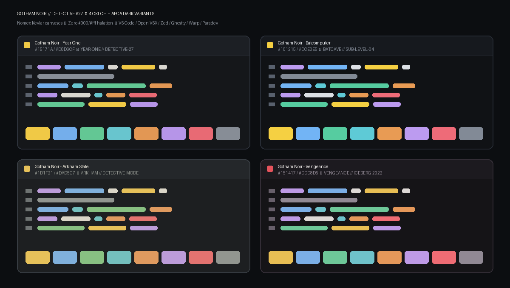

# Gotham Noir



> *"Without fear, life has no meaning."* — **Detective Comics #27 · Gotham, Year One**

**Gotham Noir** is a dark-only nocturnal theme suite built for Batman fans and **2027 AI coding agents, MLOps, DevOps, and software engineers**, uniting lore-accurate Gotham aesthetics with **OKLCH perceptual balance**, **WCAG 2.1 + APCA Lc verification**, and **dyslexia/ADHD readability**.

## 4 Lore-Accurate Dark-Only Variants

| Variant | Canvas | Foreground | Signature Accent | Lore & Era |
| :--- | :--- | :--- | :--- | :--- |
| **Gotham Noir - Year One** | `#15171A` | `#D8D6CF` | `#F0C946` GCPD Signal | *Detective Comics #27 (1939)* · *Year One (1987)* · *'89 Kevlar* |
| **Gotham Noir - Batcomputer** | `#101215` | `#DCE0E5` | `#F5D042` + `#56CCA0` Oracle | *Sub-Level 04 Mainframe* · *Lucius Fox Applied Sciences* · *Brother Eye* |
| **Gotham Noir - Arkham Slate** | `#1D1F21` | `#DAD5C7` | `#E6C15A` Antique Gold | *Arkham Island Stonework* · *Detective Mode HUD* · *3 AM Zero-Glare* |
| **Gotham Noir - Vengeance** | `#151417` | `#DDD8D5` | `#E5535C` Red Hood / Flare | *The Batman (2022)* · *Iceberg Lounge Flare* · *Mask of the Phantasm* |

## Lore & Token Codex (Easter Egg in *Inspect Editor Tokens*)

Open **Developer: Inspect Editor Tokens and Scopes** anywhere in your code to spot the WayneTech codex:

| Lore Name | Semantic Role |
| :--- | :--- |
| **Nomex Kevlar** / **Crime Alley** | Matte obsidian editor canvas & deep frame (zero `#000`/`#fff` halation) |
| **Gordon's Parchment** | Primary identifiers & high-contrast output (`11:1–14:1` WCAG) |
| **GCPD Signal** | Classes, types, interfaces, active cursor & active line number |
| **Detective Mode** | Functions, methods, Terraform resources & forensic links |
| **Oracle Emerald** | Strings, `git diff` additions & passing telemetry |
| **Cryo Sonar** | Operators, YAML/JSON keys, regex & builtins |
| **Utility Belt Brass** | Numbers, booleans, constants & function parameters |
| **Ace Chemicals Violet** | Keywords (`async`, `return`, `import`) & decorators |
| **Red Hood Crimson** / **Scarecrow Alert** | Errors, `git diff` deletions & mismatched brackets |
| **Martha's Pearl** | Language variables (`self`, `this`, `super`) & type parameters |
| **Gotham Fog** | Italic comments & docstrings |

```python
@wayne_applied_sciences(clearance="SUB-LEVEL-04")
class Batcomputer(OracleTelemetry):
    """Detective Comics #27 forensic & MLOps inference node."""
    def trace_signal(self, sector: str = "Crime Alley") -> dict[str, int]:
        nodes = {"arkham": 27, "narrows": 89, "iceberg": 2022}
        return {k: v for k, v in nodes.items() if sector != "Scarecrow"}
```

## Recommended Editor Settings (Prettier, Brackets & Dyslexia Ergonomics)

```json
{
  "workbench.colorTheme": "Gotham Noir - Year One",
  "editor.fontFamily": "'Monaspace Neon', 'Intel One Mono', 'Atkinson Hyperlegible Mono', monospace",
  "editor.fontLigatures": "'calt', 'ss01', 'ss02', 'ss03', 'zero', 'cv10'",
  "editor.lineHeight": 1.5,
  "editor.bracketPairColorization.enabled": true,
  "editor.guides.bracketPairs": "active",
  "editor.stickyScroll.enabled": true,
  "editor.semanticHighlighting.enabled": true,
  "editor.cursorBlinking": "solid",
  "editor.renderWhitespace": "boundary"
}
```

### Accessibility Font Alternatives
- **Monaspace Argon**: Wider humanist proportions with Texture Healing.
- **Intel One Mono**: Designed by Frere-Jones Type to eliminate `b/d/p/q` and `1/l/I` confusion.
- **Atkinson Hyperlegible Mono**: Braille Institute's 2025 monospaced release for maximum character distinction.
- **Commit Mono**: Clean neutral geometry with customizable alternates.

## Cross-Platform Ecosystem

Companion ports for **Ghostty** (`ghostty-theme batman` / `year-one` / `batcomputer` / `arkham` / `vengeance` + `--signal`), **Zed**, **Warp**, **Kitty**, **Alacritty**, **WezTerm**, **Windows Terminal**, **iTerm2**, **macOS Terminal.app**, **tmux**, **Paradev**, and **Regular Antigravity** live in [gotham-noir](https://github.com/thezaynahmed/gotham-noir).
